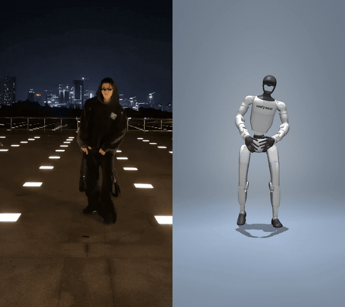
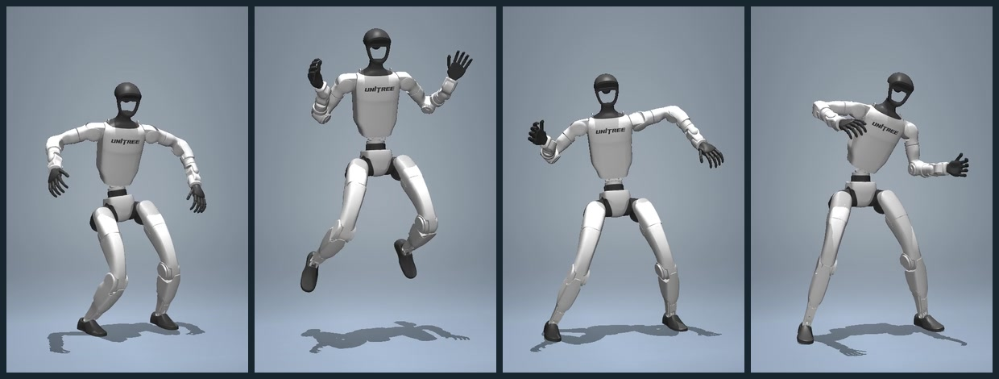
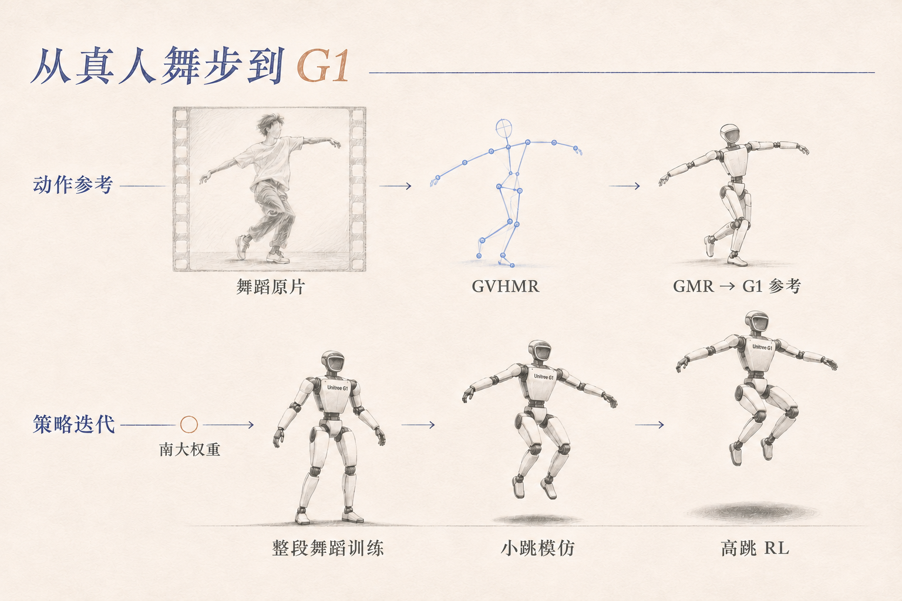

# G1-dance

在 MuJoCo 仿真环境中，让宇树 Unitree G1 跳出蔡徐坤的《Old School》。

## 实现流程

1. **动作提取与重定向**：使用 GVHMR 从原视频中恢复 3D 人体动作，再通过 GMR 重定向为 G1 的参考动作轨迹。
2. **分阶段策略训练**：
   - **全局微调（FT1）**：用整段舞蹈轨迹做强化学习微调，让策略适应整体舞步和转身。
   - **跳跃技能注入（小跳模仿）**：通过局部腿部控制示范与监督模仿学习，让 G1 学会蹬地、腾空和落稳。
   - **幅度强化（高跳 RL）**：继续用相位对齐的强化学习提高跳跃幅度，让跳跃动作更充分。

最终，G1 能在舞段的跳跃处双脚离地，稳定落地后接回后续舞步，跳完整段舞蹈。

## 演示

下面把同一段舞并排对照：左侧是原片，右侧是训练后的 G1 在 MuJoCo 中的仿真回放。



**原片来源：** 蔡徐坤官方发布的《Old School》舞蹈视频。



*蓄力 → 腾空 → 落地 → 接回舞步。四帧取自成片右栏的 G1 仿真，使用修订高跳参考和展示初态。*

## 项目流程与迭代



[GVHMR](https://github.com/zju3dv/GVHMR) 从单目视频恢复三维人体动作，[GMR](https://github.com/YanjieZe/GMR) 再把它转成 G1 的**原始参考**：逐帧给出机器人要跟随的位置、朝向和关节角度。控制策略从[南大 SuperMimic](https://github.com/NJU-R-L-Group-Embodied-Lab/SuperMimic-Repro-Sim2Real) 的发布权重起步。

1. **整段舞蹈训练（FT1）。** 用原始参考在全片上做强化学习微调。固定起点下，片尾的朝向误差从 33.2° 降到 10.8°，两版都跑完了舞段，双脚仍未同时离地。下一轮就专门解决起跳。
2. **小跳模仿。** 换成较低的跳跃目标后，增加起跳前的训练采样也没能让 G1 跳起来。我们先在跳跃段调整腿部电机指令，让 G1 蹬地、腾空、落稳，再用成功示范里的指令监督微调 FT1。撤掉辅助后，从相同的六个初态跑全片，稳定跳跃从 FT1 的 **0/6** 提高到小跳策略的 **6/6**。
3. **高跳 RL。** 把跳跃目标从约 13 cm 提到 22 cm，用同一份修订高跳参考比较三版：冻结的小跳策略、继续做强化学习、继续做监督模仿。三版都能跳起并落稳。强化学习版的双脚净空最高，跳跃之外的骨盆位置误差也最小，因此选它做成片。小跳版落地时的骨盆倾斜更小，继续保留作对照。

我们也试过从南大发布权重直接做强化学习或监督模仿，两条路线都能学会跳。直训强化学习版离地较低，直训模仿版能把脚抬得更高，躯干偏差也更大。各条路线的比较见[实验迭代](docs/iterations.md)，逐轮结果见[实验日志](docs/experiments.md)。

## 配对评测

成片展示用的是修订高跳参考，主表则把两份策略都放回**原始 G1 参考**。南大发布策略与成片 RL 在相同的仿真设置下，从同样的五组初始位姿和速度分别跑完全片。这五组初态在训练和选模型时留出，评测全程固定权重，由策略独立控制。控制频率为 50 Hz，物理状态记录频率为 200 Hz。表中的高度和误差取五组均值。

| 指标 | 南大发布策略 | 成片 RL |
| --- | ---: | ---: |
| 完成舞段且无非脚部触地 | 5/5 | 5/5 |
| 双脚腾空并稳定落地 | 0/5 | **5/5** |
| 较低一侧足底的峰值离地高度 | 0.26 cm | 22.94 cm |
| 双脚竖直轨迹 RMSE（6.32–6.56 秒） | 29.10 cm | **15.16 cm** |
| 骨盆平均位置误差 | 28.76 cm | 14.17 cm |
| 末帧绝对朝向误差 | 32.80° | 9.57° |
| 全片关节角 RMSE | 7.62° | 9.34° |

成片 RL 在五个初态下都能跳起来、落稳并接着跳完。跳跃时的脚部竖直轨迹误差下降约 48%，全片关节角误差增加了 1.72°。让两份策略共用修订高跳参考再比一次，双脚腾空并落稳同样从 0/5 提高到 5/5。两种参考的结果与指标定义见 [EXP-020 评测](docs/exp020.md)，各初态数值见[配对数据](results/oldschool/exp020.json)。

## 目录结构

```text
├── configs/
│   ├── models.json                  # 动作恢复与南大预训练权重清单
│   ├── upstream_sources.json        # 固定版本第三方源码与补丁清单
│   └── oldschool/                   # Oldschool 流程、FT1、高跳 RL 与 EXP-020 配置
├── docs/                            # 文档与演示图片（iterations / exp020 / experiments 等）
├── envs/                            # 环境定义、补丁与统一启动入口 ./envs/run.sh
├── results/oldschool/exp020.json    # 锁定的 EXP-020 逐初态评测数据
└── tools/
    ├── setup_third_party.py         # 拉取固定 commit 第三方源码并打补丁
    ├── download_models.py           # 下载公开预训练权重
    ├── check_models.py              # 校验本地模型与 SHA-256
    ├── reconstruct_motion.py        # GVHMR 人体动作恢复
    ├── prepare_training_motion.py   # G1 CSV → 50 Hz 训练 NPZ 转换
    ├── finetune_policy.py           # 第一阶段整段舞蹈微调（FT1）
    ├── evaluate_oldschool_exp020.py # EXP-020 复现评测与指标汇总
    └── oldschool/                   # 跳跃参考编辑、教师控制、模仿学习、高跳 RL 与渲染
```

## 快速开始

> 本仓库仅分发代码、配置、文档与锁定指标数据；原始视频、SMPL-X 人体模型、下载权重与训练产物不随 Git 分发。

### 1. 准备第三方代码、环境与权重

详细步骤见[环境与模型准备](docs/setup.md)及[运行环境说明](envs/README.md)。

```bash
# 拉取 GVHMR / GMR / mjlab / PyTorch3D / SuperMimic-Repro-Sim2Real 并应用补丁
python3 tools/setup_third_party.py

# 安装训练环境（需要 CUDA 与 uv）
uv sync --project envs/training

# 下载公开视觉与策略预训练权重（SMPL-X 需按 docs/setup.md 自行获取）
./envs/run.sh motion tools/download_models.py
./envs/run.sh motion tools/check_models.py --verify
```

### 2. 动作恢复、分阶段训练与评测

```bash
# 1) 从原视频恢复人体动作并转成 50 Hz G1 训练轨迹
./envs/run.sh motion tools/reconstruct_motion.py --video data/video/oldschool_full.mp4 --stage all --static-camera
./envs/run.sh training tools/prepare_training_motion.py --csv <retargeted.csv> --output outputs/motions/oldschool_full_v1.npz

# 2) 阶段一：整段舞蹈微调 (FT1)
./envs/run.sh training tools/finetune_policy.py --config configs/oldschool/ft1.json

# 3) 阶段二：生成小跳参考 + 录制教师示范 + 监督模仿 (EXP-013)
./envs/run.sh training tools/oldschool/make_jump_reference.py --mode low --raw outputs/motions/oldschool_full_v1.npz --model <g1_scene.mjb> --output <low_hop.npz> --write
./envs/run.sh training tools/oldschool/train_imitation.py capture --checkpoint <ft1_ckpt.pt> --motion <low_hop.npz> --output outputs/oldschool_imitation
./envs/run.sh training tools/oldschool/train_imitation.py train --checkpoint <ft1_ckpt.pt> --data outputs/oldschool_imitation/supervision.npz --output outputs/training/oldschool_jump_imitation

# 4) 阶段三：生成高跳参考 + 合并热启动权重 + 分阶段高跳 RL (EXP-017)
./envs/run.sh training tools/oldschool/make_jump_reference.py --mode high --raw outputs/motions/oldschool_full_v1.npz --low-hop <low_hop.npz> --model <g1_scene.mjb> --output <higher_hop.npz> --write
./envs/run.sh training tools/oldschool/train_hop_rl.py prepare --actor outputs/training/oldschool_jump_imitation/ckpt_actor.pt --wm-source <ft1_ckpt.pt> --output <warm_start.pt>
./envs/run.sh training tools/oldschool/train_hop_rl.py run --mode staged --config configs/oldschool/higher_hop_rl.json

# 5) 复算主表指标或重跑 EXP-020 配对物理评测
python3 tools/evaluate_oldschool_exp020.py report
```

## 文档导航

- [环境与模型准备](docs/setup.md) · [运行环境说明](envs/README.md)
- [实验迭代总览](docs/iterations.md)
- [EXP-020 同参考直评](docs/exp020.md)
- [原版策略对照（EXP-016）](docs/policy_comparison.md)
- [南大直训路线对照（EXP-018）](docs/nju_direct_training.md)
- [完整实验日志（EXP-010 ~ EXP-020）](docs/experiments.md)

## 致谢与协议

本项目从南大 [SuperMimic-Repro-Sim2Real](https://github.com/NJU-R-L-Group-Embodied-Lab/SuperMimic-Repro-Sim2Real) 发布的预训练权重起步。南大项目的训练实现基于 CuboiLeo 在 mjlab / MuJoCo Warp 上的独立复现 [SuperMimic-Reproduced](https://github.com/CuboiLeo/SuperMimic-Reproduced)，方法源自 [SuperMimic 论文](https://arxiv.org/abs/2610.28480)。部分微调与仿真录制脚本改编自 [Skura3/g1-dance-rtx3050](https://github.com/Skura3/g1-dance-rtx3050)。

本仓库自有代码与文档基于 [MIT License](LICENSE) 开源；各第三方依赖协议详见 [THIRD_PARTY_NOTICES.md](THIRD_PARTY_NOTICES.md)。
