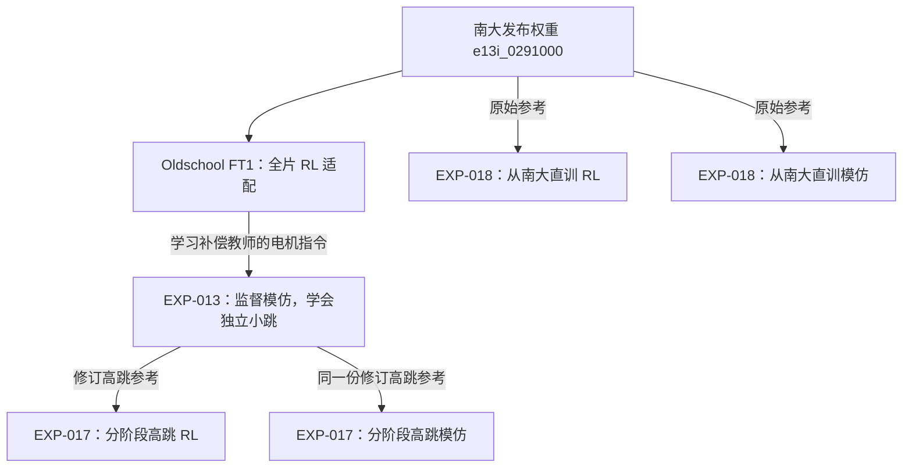

# Oldschool：从跑完全片到跳得更接近参考

目标是在 G1 仿真中复现一段 11.94 秒的 Oldschool 舞蹈。起跳要让身体升起来，收腿、开脚和落地要跟上节拍，落地之后还要接回后面的舞步。最初的策略已经能跑完全片，迭代从定位为什么跳不起来开始。每轮用全片回放检查局部改动有没有影响后续舞步。

## 策略是怎么迭代的

图中的箭头表示策略权重从哪里继承。EXP-017 的 **Frozen** 是 EXP-013 小跳学生的冻结副本，用来量这轮新增训练带来的变化。原版 FT1 是小跳训练之前的检查点。南大发布权重则用于量整个项目相对于公开起点的变化。完整逐轮配置与数据见[实验日志](experiments.md)。

| 问题 | 观察和决策 |
|---|---|
| **发布策略在哪一步掉队？** | 在 Oldschool 的固定起点，南大原版和全片 RL 适配后的 FT1 都跑完了全片。FT1 的末帧朝向误差从 33.2° 降至 10.8°，全片关节误差从 7.50° 升至 9.35°，两版都未双脚腾空。保留原版对照和 FT1 权重，先把问题收窄到起跳。见[项目进度](experiments.md#共同输入与起点2026-11-11)。 |
| **改参考或多练起跳就够了吗？** | 原始 GVHMR→GMR→G1 参考在空中的质心加速度拟合约为 −6.15 m/s²，与仿真重力 −9.81 m/s² 不符。改成约 12.7 cm 的小跳参考后，同一冻结 FT1 在固定起点仍跳不起来。固定该参考、只在跳跃段修正腿部电机目标，做出了腾空和稳定落地（EXP-010/011），给出了可行的控制示范。随后只增加起跳前采样的 RL A/B 中，窗口访问量增加约 31%，两组仍各为 0/5。结果支持尝试把已有示范教给策略。见[采样对照](experiments.md#exp-0122026-11-12增加起跳前采样的微调-ab)。 |
| **能把示范变成策略自己的能力吗？** | 用教师实际发出的电机指令监督微调 FT1。评测时关掉补偿，从同样的六个初态跑全片：FT1 0/6，学生 6/6 腾空并稳定落地。全片保护线通过 5/6，仍有一个起点片尾退步。这是保留小跳权重、用它做下一轮起点的依据。见[小跳模仿](experiments.md#exp-0132026-11-12用成功蹬地指令做模仿微调)。 |
| **会小跳以后，两种方法各能改善什么？** | EXP-017 把约 22 cm 的修订高跳参考同时给冻结对照、RL 和监督模仿；两条训练路线共享小跳 actor 起点。六个配对初态下，较低脚离地峰值均值为 11.03 / 23.58 / 21.82 cm，三组均 6/6 跳起并落稳。RL 提高了脚高并降低了跳跃之外的平均骨盆位置误差；模仿的收腿和开脚更接近原始 G1 参考，触地时机更接近共用高跳参考。两版落地都更倾斜，RL 在两个留出起点的末帧朝向退步约 8.9°、10.3°，超过预设的 3° 保护线；模仿版的片尾和跳跃外位置也有退化。小跳版仍保留。见[高跳对照](experiments.md#exp-0172026-11-13同一较高跳目标的强化学习与监督模仿)。 |
| **跳跃收益是否依赖已有的小跳权重？** | EXP-018 回到同一份南大发布权重和未经修改的原始参考，分别直训 RL 和模仿，不继承本地权重或示范轨迹。原版 0/6 腾空并落稳，两种直训各为 6/6。直训 RL 的右膝和开脚幅度有改善，但左膝退化、较低脚平均仅 3.64 cm；直训模仿的脚高达到 31.35 cm，但身姿偏差更大。两版全片关节误差都高于发布策略。这表明直接训练也能学会该片段的跳跃，分阶段路线的价值需要看动作质量和全片取舍。见[南大直训](nju_direct_training.md)。 |

EXP-016 是另一项对照：在原始参考和小跳参考上分别配对比较发布策略与 EXP-013 学生。原始参考下，学生从 0/6 提高到 6/6 腾空并落稳，末帧朝向平均误差从 31.58° 降至 6.95°，全片关节误差从 7.58° 升至 9.41°。这衡量的是两份成品权重的净差异，其中包括全片适配和示范学习。见[发布策略对照](policy_comparison.md)。

## 为什么保留分阶段 RL 作为候选

[离线复算](experiments.md#exp-0192026-11-13已有跳跃路线的离线原因分析)把较低脚净空、整机质心上升和躯干误差分开。较低脚的离地峰值是每帧先取两脚中更低的一只，再取该段的峰值，既受身体上升影响，也受收腿影响。以下为相同六个初态的均值；躯干与全片关节误差统一按原始 G1 重定向参考计算。

| 指标 | EXP-017 分阶段 RL | EXP-018 南大直训 RL | EXP-018 南大直训模仿 |
|---|---:|---:|---:|
| 较低脚离地峰值 | 23.58 cm | 3.64 cm | 31.35 cm |
| 整机质心从离地到最高点上升 | 10.08 cm | 5.31 cm | 4.58 cm |
| 跳跃窗躯干倾斜方向 RMSE | 6.24° | 4.27° | 12.74° |
| 全片关节角 RMSE | 9.31° | 8.14° | 8.24° |

分阶段 RL 在这几份成品中，身体升得最高，躯干误差比直训模仿小。直训模仿的脚净空更大，但更多来自收腿；教师也有相似的躯干误差（13.15°，学生 12.74°），改善教师的全身协调比继续压低动作拟合误差更有针对性。直训 RL 的躯干和全片关节误差仍更低。我们用分阶段 RL 做成片。EXP-017 中，成片版相对冻结小跳策略的片尾退化超过了预设保护线，小跳版也继续保留。

真人视频用于视觉对齐，约 37.8 cm 是未经修改的 G1 重定向参考中的几何峰值。修订参考用来给训练提供更可行的质心轨迹。是否完成跳跃和落地用仿真接触和支撑状态判定，参考文件的脚高和近地时刻不能代替这些证据。

## 成片和南大发布策略怎么比

[EXP-020](exp020.md)把南大发布策略和成片权重放到同一份参考、同一批初态里。原始 G1 参考和修订高跳参考各比一次。两种参考下，稳定跳跃均从 0/5 提高到 5/5；成片对双脚竖直轨迹、骨盆位置和片尾朝向跟得更准，全片关节角误差更大。这一轮回答的是从发布权重到成片，整条路线最终带来了哪些变化。

## 对照能回答到哪一步

EXP-017 和 EXP-018 各自在同初态、同参考、无补偿、无中途重置下比较本轮方案。每轮六个初态包括一个开发起点和五个未用于训练或选点的起点。这检验的是一份策略在不同起点下的表现。两种训练路线所用数据、教师搜索和计算量不同，结果只支持这一段舞、这几套训练方案的比较。

跨轮结果可用于选择接下来研究哪份成品。两轮同时改变了起始策略、世界模型和价值网络的初始状态、训练参考、奖励、重置与动作噪声等条件，分阶段路线还用了前置训练和示范搜索。已有对照能量出某一步对当时策略的改善，无法拆出它对最终高跳方案的单独贡献。若要比较整条路线的计算效率，还需要计入前置续训与教师搜索。现有结论也未在其他舞蹈、多个独立训练种子或实机上验证。

最直接的后续对照是固定高跳参考、奖励、采样、可训练层和追加预算，统一世界模型、价值网络和优化器的起始条件，仅替换 actor：南大原版、FT1、EXP-013 小跳学生。前两组比较全片适配对初始化的作用，后两组比较在 FT1 之上加入小跳示范的作用。用多个独立训练种子复跑，检查点锁定后在相同的留出初态上评测：身体是否升得更高，姿态及落地是否更接近目标，每个起点的片尾及跳跃外误差是否守住保护线。若要回答修订训练参考本身的效果，再从同一 actor 分别用原始参考和修订参考训练，固定其他设置并统一评测口径。
